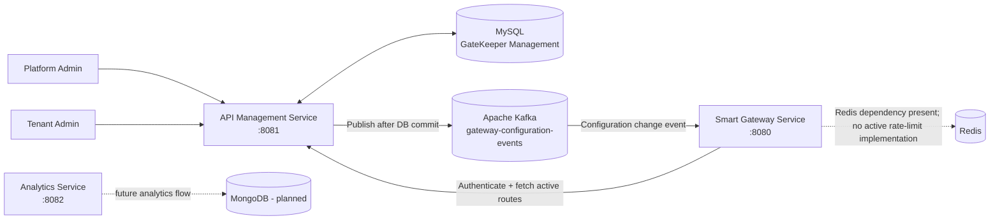
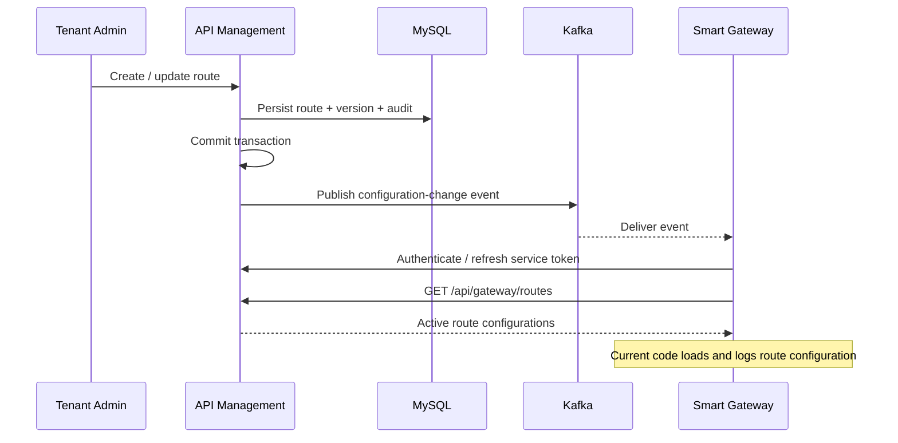

# GateKeeper

**A multi-tenant API management platform with an event-driven gateway configuration service.**

GateKeeper is a Spring Boot-based project that separates API administration from gateway-side configuration retrieval. Platform administrators manage organizations and tenant administrators manage their API routes. Changes to route configurations are versioned, audited, and published through Apache Kafka so the Smart Gateway Service can refresh its configuration.

> **Implementation status:** The current source implements API management, authentication and authorization, route configuration/versioning, audit records, Kafka-based configuration notifications, and gateway-side configuration loading. The Smart Gateway currently fetches and logs active route configurations; full inbound request proxying/forwarding to downstream services is not implemented in this snapshot. The Analytics Service is currently a service scaffold with a health endpoint, not a complete analytics pipeline.

## Contents

- [Architecture](#architecture)
- [Services](#services)
- [Features](#features)
- [Technology stack](#technology-stack)
- [Repository structure](#repository-structure)
- [Prerequisites](#prerequisites)
- [Local setup](#local-setup)
- [Configuration](#configuration)
- [API overview](#api-overview)
- [Configuration event flow](#configuration-event-flow)
- [Security model](#security-model)
- [Current scope and next steps](#current-scope-and-next-steps)

## Architecture

GateKeeper follows a control-plane/data-plane-inspired separation:

- **API Management Service (control plane):** Owns organizations, users, route definitions, route versions, and audit records.
- **Smart Gateway Service:** Authenticates with the management service, retrieves active route definitions, and refreshes its configuration when it receives Kafka notifications.
- **Analytics Service:** Reserved for access-event storage and API usage analytics. The current implementation is a scaffold.



## Services

| Service | Default port | Responsibility | Current implementation |
|---|---:|---|---|
| API Management Service | `8081` | Organization and tenant administration, login, route CRUD, route versioning, audit records, gateway configuration API | Implemented with MySQL/JPA and Flyway |
| Smart Gateway Service | `8080` | Service authentication, active-route retrieval, Kafka event consumption, configuration refresh | Configuration loading and refresh are implemented; request proxying is not yet implemented |
| Analytics Service | `8082` | Intended access-event storage and usage analytics | Scaffold with application and health endpoint |

## Features

### Organization and tenant management

- Platform-level organization creation, retrieval, update, status changes, and deletion.
- Tenant administrator creation and management for an organization.
- Organization status validation during authentication and tenant operations.
- Tenant-scoped route access based on the organization identifier in the authenticated JWT.

### API route management

- Create, list, retrieve, update, activate/deactivate, and delete API route definitions.
- Configure route identifiers, path patterns, target base URLs, target path prefixes, and allowed HTTP methods.
- Store route policy fields such as requests per minute, response timeout, idempotency setting, and request/response header rules.
- Validate route input and prevent duplicate route identifiers within an organization.

**Note:** These policy values are managed as configuration data in the current snapshot. Enforcement of rate limits, response timeouts, idempotency, header transformations, and downstream proxying is not implemented in the Smart Gateway yet.

### Versioning and auditability

- Increment route configuration versions when routes are created, updated, activated/deactivated, or deleted.
- Persist configuration snapshots for route history.
- Record control-plane actions with organization, action, resource, correlation, and execution timing information where provided by the audit implementation.

### Event-driven configuration refresh

- Publish a gateway configuration change event after the management database transaction commits.
- Use an organization/route-based Kafka message key.
- Consume configuration notifications in the Smart Gateway Service.
- Refresh the active route list from the management API after receiving an event.
- Authenticate the gateway service using a dedicated service account and bearer token; refresh the token before expiry and retry once after an unauthorized response.

## Technology stack

| Category | Technologies |
|---|---|
| Language / runtime | Java 21 |
| Backend framework | Spring Boot 4.1.1, Spring MVC |
| Security | Spring Security, OAuth2 Resource Server, JWT, BCrypt |
| Persistence | Spring Data JPA, Hibernate |
| Relational database | MySQL |
| Database migrations | Flyway |
| Messaging | Apache Kafka, Spring Kafka |
| Cache / infrastructure dependency | Redis (dependency and local container included; no completed rate-limiting flow in this snapshot) |
| Analytics persistence dependency | MongoDB (declared by Analytics Service; analytics implementation is not complete) |
| Build | Maven |
| Local infrastructure | Docker Compose |

## Repository structure

```text
 gatekeeper/
 ├── api-management-service/
 │   ├── src/main/java/.../management/
 │   │   ├── config/          # Security and Kafka configuration
 │   │   ├── controller/      # Authentication, platform, tenant, gateway APIs
 │   │   ├── dto/              # Request and response DTOs
 │   │   ├── entity/           # Organizations, users, routes, versions, audit records
 │   │   ├── event/            # Configuration events and Kafka publisher
 │   │   ├── exception/        # API exceptions and global handler
 │   │   ├── repository/       # Spring Data repositories
 │   │   └── service/          # Business logic and tenant context
 │   └── src/main/resources/
 │       ├── db/migration/     # Flyway SQL migrations
 │       └── static/           # Basic management UI assets
 ├── smart-gateway-service/
 │   └── src/main/java/.../gateway/
 │       ├── client/           # Management API client
 │       ├── config/           # Security and Kafka configuration
 │       ├── dto/              # Gateway route and authentication DTOs
 │       ├── event/            # Kafka configuration event consumer
 │       └── service/          # Initial configuration loader
 ├── analytics-service/
 │   └── src/main/java/.../analytics/ # Analytics service scaffold
 ├── compose.yaml              # Local Kafka and Redis containers
 └── README.md
```

## Prerequisites

Install the following before running the services:

- JDK 21
- Docker Desktop or Docker Engine with the Compose plugin
- MySQL 8.x (or a compatible MySQL server)
- Maven (optional if using the included Maven Wrapper scripts)

## Local setup

### 1. Start Kafka and Redis

From the `gatekeeper` project root:

```bash
docker compose up -d
```

This starts:

- Kafka at `localhost:9092`
- Redis at `localhost:6379`

The supplied Compose configuration is intended for local development, not production deployment.

### 2. Create the MySQL database

Create the database used by the API Management Service:

```sql
CREATE DATABASE gatekeeper_management;
```

The service uses Flyway migrations from `api-management-service/src/main/resources/db/migration/` to create and seed its schema.

### 3. Configure application properties

Before starting the services, review the following files:

- `api-management-service/src/main/resources/application.properties`
- `smart-gateway-service/src/main/resources/application.properties`
- `analytics-service/src/main/resources/application.properties`

Update the MySQL URL, username, and password in the API Management Service configuration to match your local database. Also replace the demo JWT secret and gateway service credentials with your own local values.

The Smart Gateway Service supports these environment-variable overrides:

| Variable | Default | Purpose |
|---|---|---|
| `GATEKEEPER_GATEWAY_USERNAME` | `gateway-service` | Gateway service account username |
| `GATEKEEPER_GATEWAY_PASSWORD` | `gateway123` | Gateway service account password |
| `GATEKEEPER_MANAGEMENT_URL` | `http://localhost:8081` | API Management Service base URL |
| `GATEKEEPER_CONFIGURATION_TOPIC` | `gateway-configuration-events` | Kafka configuration topic |
| `GATEKEEPER_CONFIGURATION_GROUP` | `smart-gateway-configuration` | Kafka consumer group |
| `GATEKEEPER_KAFKA_SERVERS` | `localhost:9092` | Kafka bootstrap servers |

The API Management Service currently declares its datasource credentials and JWT secret directly in `application.properties`; edit those values locally before running. Do not commit real credentials or production secrets.

### 4. Run the API Management Service

In a terminal:

```bash
cd api-management-service
./mvnw spring-boot:run
```

On Windows, use:

```powershell
mvnw.cmd spring-boot:run
```

The service starts on `http://localhost:8081` by default.

### 5. Run the Smart Gateway Service

In another terminal, from the project root:

```bash
cd smart-gateway-service
./mvnw spring-boot:run
```

The service starts on `http://localhost:8080` by default. At startup it authenticates with the management service and loads the active route configuration. It also listens for configuration-change events on the configured Kafka topic.

### 6. Run the Analytics Service (optional)

In another terminal:

```bash
cd analytics-service
./mvnw spring-boot:run
```

The service starts on `http://localhost:8082`. Its current implementation is only a scaffold; a MongoDB instance and analytics ingestion/aggregation logic are not yet wired into a complete workflow.

## Configuration

### Default local service addresses

| Component | Address |
|---|---|
| Smart Gateway Service | `http://localhost:8080` |
| API Management Service | `http://localhost:8081` |
| Analytics Service | `http://localhost:8082` |
| Kafka | `localhost:9092` |
| Redis | `localhost:6379` |
| MySQL | `localhost:3306` (configure separately) |

### Kafka topic

The default configuration topic is `gateway-configuration-events`. The API Management Service publishes route-change events after successful database commits; the Smart Gateway Service consumes those events and fetches the current active route list from the management API.

## API overview

All management endpoints are served by the API Management Service on port `8081`. Protected endpoints require a bearer JWT obtained from the login endpoint.

### Authentication

| Method | Endpoint | Description |
|---|---|---|
| `POST` | `/api/auth/login` | Authenticate a user and receive a JWT |

### Platform administration

| Method | Endpoint | Description |
|---|---|---|
| `POST` | `/api/platform/organizations` | Create an organization |
| `GET` | `/api/platform/organizations` | List organizations |
| `GET` | `/api/platform/organizations/{id}` | Retrieve an organization |
| `PUT` | `/api/platform/organizations/{id}` | Update an organization |
| `PATCH` | `/api/platform/organizations/{id}/status` | Change organization status |
| `DELETE` | `/api/platform/organizations/{id}` | Delete an organization |
| `POST` | `/api/platform/organizations/{organizationId}/tenant-admin` | Create a tenant administrator |
| `GET` | `/api/platform/organizations/{organizationId}/tenant-admin` | Retrieve tenant administrator |
| `PUT` | `/api/platform/organizations/{organizationId}/tenant-admin` | Update tenant administrator |
| `DELETE` | `/api/platform/organizations/{organizationId}/tenant-admin` | Delete tenant administrator |

### Tenant route management

| Method | Endpoint | Description |
|---|---|---|
| `POST` | `/api/tenant/routes` | Create a route |
| `GET` | `/api/tenant/routes` | List routes for the authenticated tenant |
| `GET` | `/api/tenant/routes/{id}` | Retrieve a tenant-owned route |
| `PUT` | `/api/tenant/routes/{id}` | Update a route |
| `PATCH` | `/api/tenant/routes/{id}/status` | Activate or deactivate a route |
| `DELETE` | `/api/tenant/routes/{id}` | Delete a route |
| `GET` | `/api/tenant/route-versions/{routeId}` | List configuration versions for a route |
| `GET` | `/api/tenant/audit-records` | Retrieve tenant audit records |

### Gateway configuration

| Method | Endpoint | Description |
|---|---|---|
| `GET` | `/api/gateway/routes` | Retrieve active routes for active organizations; intended for the gateway service account |

### Health

| Method | Endpoint | Description |
|---|---|---|
| `GET` | `/health` | API Management Service health information |
| `GET` | `/health` | Analytics Service health information |

## Configuration event flow

1. A tenant administrator creates, updates, activates/deactivates, or deletes a route.
2. The API Management Service persists the route change, creates a version snapshot, and records an audit action within the management workflow.
3. The service raises an application event during the transaction.
4. A transactional event listener publishes the Kafka notification **after the database transaction commits**.
5. The Smart Gateway Service consumes the notification.
6. The gateway authenticates with the management service if its service token is missing or close to expiry, then requests the current active route list from `GET /api/gateway/routes`.



## Security model

- Stateless Spring Security configuration.
- JWT bearer-token authentication using HMAC SHA-256 (HS256).
- Password hashes verified using BCrypt.
- Role-based access for `PLATFORM_ADMIN`, `TENANT_ADMIN`, and `GATEWAY_SERVICE`.
- Tenant context is derived from the authenticated token's `organizationId` claim, and route queries are scoped to that organization.
- Gateway-to-management API calls use a dedicated gateway service account.

**Production hardening required:** Replace all demo credentials and secrets, store secrets outside source control, use TLS, review token rotation and service-account lifecycle, and harden Kafka/Redis/MySQL networking and access controls before deployment.

## Current scope and next steps

The following are logical next steps, not claims about completed functionality:

- Implement inbound request matching and proxy forwarding to configured downstream services.
- Enforce configured rate limits, response timeouts, idempotency behavior, and header rules in the gateway request pipeline.
- Add Redis-backed distributed rate limiting and define failure behavior for Redis outages.
- Add gateway integration tests for route matching, forwarding, filters, and downstream failures.
- Build the Analytics Service ingestion and aggregation pipeline, including persistence and query APIs.
- Add operational observability such as structured logs, metrics, tracing, and dashboards.
- Externalize all credentials and secrets and provide production-oriented deployment configuration.

## Running tests

Run the tests for each service from its own directory:

```bash
./mvnw test
```

Repeat in `api-management-service`, `smart-gateway-service`, and `analytics-service`. The test suite and external infrastructure requirements may differ by service.

## License

No license file was included in the supplied project snapshot. Add a `LICENSE` file before redistributing the project, and ensure that any upstream course material or assets are used in accordance with their applicable terms.
